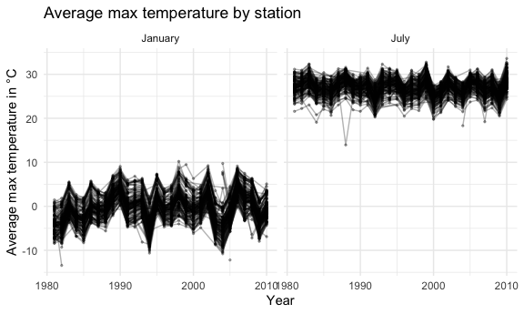
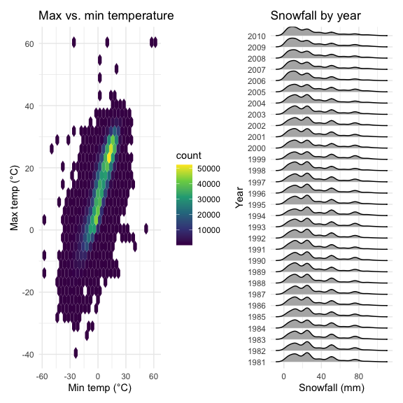
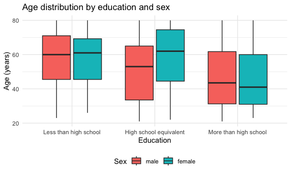
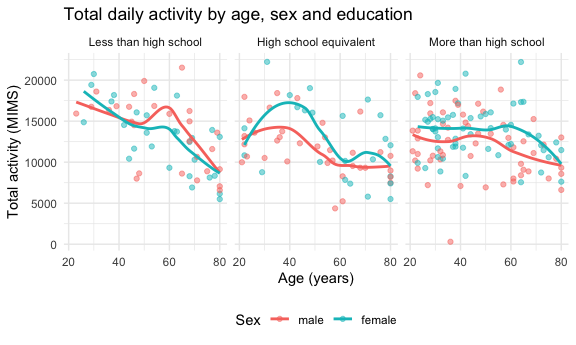
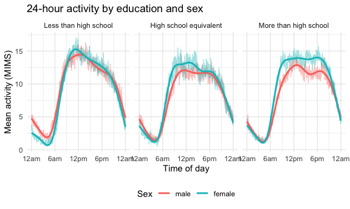
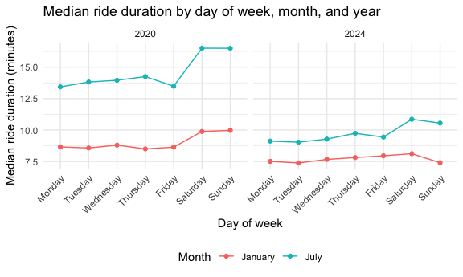
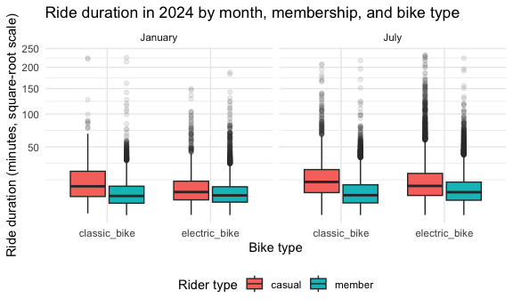

p8105_hw3_zg2582
================
Zaixin Gao
2026-10-16

## Problem 1

``` r
library(tidyverse)
```

    ## ── Attaching core tidyverse packages ──────────────────────── tidyverse 2.0.0 ──
    ## ✔ dplyr     1.2.1     ✔ readr     2.2.0
    ## ✔ forcats   1.0.1     ✔ stringr   1.6.0
    ## ✔ ggplot2   4.0.3     ✔ tibble    3.3.1
    ## ✔ lubridate 1.9.5     ✔ tidyr     1.3.2
    ## ✔ purrr     1.2.2     
    ## ── Conflicts ────────────────────────────────────────── tidyverse_conflicts() ──
    ## ✖ dplyr::filter() masks stats::filter()
    ## ✖ dplyr::lag()    masks stats::lag()
    ## ℹ Use the conflicted package (<http://conflicted.r-lib.org/>) to force all conflicts to become errors

``` r
library(p8105.datasets)
library(patchwork)
library(ggridges)

knitr::opts_chunk$set(
  fig.width = 6,
  fig.asp = .6,
  out.width = "90%"
)

theme_set(theme_minimal() + theme(legend.position = "bottom"))

options(
  ggplot2.continuous.colour = "viridis",
  ggplot2.continuous.fill = "viridis"
)
```

``` r
data("ny_noaa")
```

``` r
## A noaa sumnary
n_rows = nrow(ny_noaa)
n_cols = ncol(ny_noaa)
n_stations = n_distinct(pull(ny_noaa, id))
first_date = min(pull(ny_noaa, date))
last_date = max(pull(ny_noaa, date))
pct_missing_prcp = round(mean(is.na(pull(ny_noaa, prcp))) * 100, 1)
pct_missing_snow = round(mean(is.na(pull(ny_noaa, snow))) * 100, 1)
pct_missing_tmax = round(mean(is.na(pull(ny_noaa, tmax))) * 100, 1)
```

The dataset contains daily weather records from 747 weather stations in
New York, from 1981-01-01 to 2010-12-31. It has 2595176 rows and 7
columns. Missing data is a major issue, especially for maximum
temperature, 43.7% of values are missing, compared with 14.7% of
snowfall and 5.6% of precipitation values.

``` r
## Data cleaning
ny_noaa |> drop_na(tmax) |> pull(tmax) |> head()
```

    ## [1] "-56"  "-89"  "-122" "-94"  "-56"  "-117"

``` r
noaa_df =
  ny_noaa |> separate(date, into = c("year", "month", "day"), sep = "-") |>
  mutate(
    year = as.numeric(year),
    month = as.numeric(month),
    day = as.numeric(day),
    tmax = as.numeric(tmax) / 10,
    tmin = as.numeric(tmin) / 10,
    prcp = prcp / 10)
```

### For snowfall, what are the most commonly observed values? Why?

``` r
noaa_df |>
  count(snow) |>
  arrange(desc(n))
```

    ## # A tibble: 282 × 2
    ##     snow       n
    ##    <int>   <int>
    ##  1     0 2008508
    ##  2    NA  381221
    ##  3    25   31022
    ##  4    13   23095
    ##  5    51   18274
    ##  6    76   10173
    ##  7     8    9962
    ##  8     5    9748
    ##  9    38    9197
    ## 10     3    8790
    ## # ℹ 272 more rows

The most common snowfall value is 0, because it does not snow on most
days of the year.

### Make a two-panel plot showing the average max temperature in January and in July in each station across years. Is there any observable / interpretable structure? Any outliers?

``` r
noaa_df |>
  filter(month == 1 | month == 7) |>
  mutate(month = case_match(month, 1 ~ "January", 7 ~ "July")) |>
  group_by(id, year, month) |>
  summarize(mean_tmax = mean(tmax, na.rm = TRUE)) |>
  drop_na(mean_tmax) |>
  ggplot(aes(x = year, y = mean_tmax, group = id)) +
  geom_point(alpha = .3, size = .5) +
  geom_line(alpha = .3) +
  facet_grid(. ~ month) +
  labs(
    title = "Average max temperature by station",
    x = "Year",
    y = "Average max temperature in °C"
  )
```

    ## `summarise()` has regrouped the output.
    ## ℹ Summaries were computed grouped by id, year, and month.
    ## ℹ Output is grouped by id and year.
    ## ℹ Use `summarise(.groups = "drop_last")` to silence this message.
    ## ℹ Use `summarise(.by = c(id, year, month))` for per-operation grouping
    ##   (`?dplyr::dplyr_by`) instead.



Average max temperatures in July is around 25–30°C and are much higher
than in January (-5 to 5°C), and January varies more from year to year.
There are a few outliers, such as individual stations with a super cold
July or January compared with others in the same year.

### Make a two-panel plot showing (i) tmax vs tmin for the full dataset (note that a scatterplot may not be the best option); and (ii) make a plot showing the distribution of snowfall values greater than 0 and less than 100 separately by year.

``` r
tmax_tmin_plot =
  noaa_df |>
  ggplot(aes(x = tmin, y = tmax)) +
  geom_hex() +
  labs(
    title = "Max vs. min temperature",
    x = "Min temp (°C)",
    y = "Max temp (°C)"
  ) +
  theme(legend.position = "right")

snow_plot =
  noaa_df |>
  filter(snow > 0, snow < 100) |>
  mutate(year = factor(year)) |>
  ggplot(aes(x = snow, y = year)) +
  geom_density_ridges(scale = .85) +
  labs(
    title = "Snowfall by year",
    x = "Snowfall (mm)",
    y = "Year"
  )

tmax_tmin_plot + snow_plot
```

    ## Picking joint bandwidth of 3.76



Max and min temperature have a strong positive relationship. And the
snowfall distributions are very similar across years.

## Problem 2

### Load, tidy, merge, and otherwise organize the data sets

``` r
covar_df =
  read_csv("./data/nhanes_covar.csv", skip = 4, na = c("NA", "", ".")) |>
  janitor::clean_names() |>
  filter(age >= 21) |>
  drop_na() |>
  mutate(
    sex = case_match(sex, 1 ~ "male", 2 ~ "female"),
    sex = factor(sex, levels = c("male", "female")),
    education = case_match(
      education,
      1 ~ "Less than high school",
      2 ~ "High school equivalent",
      3 ~ "More than high school"),
    education = factor(
      education,
      levels = c("Less than high school", "High school equivalent", "More than high school")))
```

    ## Rows: 250 Columns: 5
    ## ── Column specification ────────────────────────────────────────────────────────
    ## Delimiter: ","
    ## dbl (5): SEQN, sex, age, BMI, education
    ## 
    ## ℹ Use `spec()` to retrieve the full column specification for this data.
    ## ℹ Specify the column types or set `show_col_types = FALSE` to quiet this message.

``` r
accel_df =
  read_csv("./data/nhanes_accel.csv") |>
  janitor::clean_names() |>
  pivot_longer(
    min1:min1440,
    names_to = "minute",
    names_prefix = "min",
    values_to = "mims") |>
  mutate(minute = as.numeric(minute))
```

    ## Rows: 250 Columns: 1441
    ## ── Column specification ────────────────────────────────────────────────────────
    ## Delimiter: ","
    ## dbl (1441): SEQN, min1, min2, min3, min4, min5, min6, min7, min8, min9, min1...
    ## 
    ## ℹ Use `spec()` to retrieve the full column specification for this data.
    ## ℹ Specify the column types or set `show_col_types = FALSE` to quiet this message.

``` r
nhanes_df =
  inner_join(covar_df, accel_df, by = "seqn")
```

### Produce a reader-friendly table for the number of men and women in each education category,

``` r
covar_df |>
  count(education, sex) |>
  pivot_wider(
    names_from = sex,
    values_from = n) |>
  knitr::kable()
```

| education              | male | female |
|:-----------------------|-----:|-------:|
| Less than high school  |   27 |     28 |
| High school equivalent |   35 |     23 |
| More than high school  |   56 |     59 |

### and create a visualization of the age distributions for men and women in each education category.

``` r
covar_df |>
  ggplot(aes(x = education, y = age, fill = sex)) +
  geom_boxplot() +
  labs(
    title = "Age distribution by education and sex",
    x = "Education",
    y = "Age (years)",
    fill = "Sex")
```



According to the table, more than high school category has the most
participants. In the high school equivalent category, men outnumber
women, others have more women. Participants with less than high school
education tend to be older, and those with more than high school
education tend to be younger. Women in the high school equivalent group
are older on average than men in that group.

### Using your tidied dataset, aggregate across minutes to create a total activity variable for each participant.

``` r
total_activity_df =
  nhanes_df |>
  group_by(seqn, sex, age, education) |>
  summarize(total_activity = sum(mims))
```

### Plot these total activities (y-axis) against age (x-axis); your plot should compare men to women and have separate panels for each education level. Include a trend line or a smooth to illustrate differences.

``` r
total_activity_df |>
  ggplot(aes(x = age, y = total_activity, color = sex)) +
  geom_point(alpha = .5) +
  geom_smooth(se = FALSE) +
  facet_grid(. ~ education) +
  labs(
    title = "Total daily activity by age, sex and education",
    x = "Age (years)",
    y = "Total activity (MIMS)",
    color = "Sex")
```



In all education groups, total activity tends to decrease with age.
Women tend to have higher total activity than men in the high school
equivalent and more than high school groups. In the less than high
school group, activity declines more steeply with age.

### Make a three-panel plot that shows the 24-hour activity time courses for each education level and use color to indicate sex. Describe in words any patterns or conclusions you can make based on this graph; including smooth trends may help identify differences.

``` r
nhanes_df |>
  group_by(education, sex, minute) |>
  summarize(mean_mims = mean(mims)) |>
  ggplot(aes(x = minute, y = mean_mims, color = sex)) +
  geom_line(alpha = .4) +
  geom_smooth(se = FALSE) +
  facet_grid(. ~ education) +
  scale_x_continuous(
    breaks = c(0, 360, 720, 1080, 1440),
    labels = c("12am", "6am", "12pm", "6pm", "12am")) +
  labs(
    title = "24-hour activity by education and sex",
    x = "Time of day",
    y = "Mean activity (MIMS)",
    color = "Sex")
```



In all three education groups, activity is lowest overnight, rises
sharply in the morning, stays high through the day, and declines in the
evening. The overall shape is very similar across education levels.
Women tend to have slightly higher activity than men, while differences
overnight are small.

## Problem 3

### Import, clean, and tidy these data,

``` r
jan_2020_df =
  read_csv("./data/Jan 2020 Citi.csv") |>
  janitor::clean_names() |>
  mutate(year = 2020, month = "January")
```

    ## Rows: 12420 Columns: 7
    ## ── Column specification ────────────────────────────────────────────────────────
    ## Delimiter: ","
    ## chr (6): ride_id, rideable_type, weekdays, start_station_name, end_station_n...
    ## dbl (1): duration
    ## 
    ## ℹ Use `spec()` to retrieve the full column specification for this data.
    ## ℹ Specify the column types or set `show_col_types = FALSE` to quiet this message.

``` r
jul_2020_df =
  read_csv("./data/July 2020 Citi.csv") |>
  janitor::clean_names() |>
  mutate(year = 2020, month = "July")
```

    ## Rows: 21048 Columns: 7
    ## ── Column specification ────────────────────────────────────────────────────────
    ## Delimiter: ","
    ## chr (6): ride_id, rideable_type, weekdays, start_station_name, end_station_n...
    ## dbl (1): duration
    ## 
    ## ℹ Use `spec()` to retrieve the full column specification for this data.
    ## ℹ Specify the column types or set `show_col_types = FALSE` to quiet this message.

``` r
jan_2024_df =
  read_csv("./data/Jan 2024 Citi.csv") |>
  janitor::clean_names() |>
  mutate(year = 2024, month = "January")
```

    ## Rows: 18861 Columns: 7
    ## ── Column specification ────────────────────────────────────────────────────────
    ## Delimiter: ","
    ## chr (6): ride_id, rideable_type, weekdays, start_station_name, end_station_n...
    ## dbl (1): duration
    ## 
    ## ℹ Use `spec()` to retrieve the full column specification for this data.
    ## ℹ Specify the column types or set `show_col_types = FALSE` to quiet this message.

``` r
jul_2024_df =
  read_csv("./data/July 2024 Citi.csv") |>
  janitor::clean_names() |>
  mutate(year = 2024, month = "July")
```

    ## Rows: 47156 Columns: 7
    ## ── Column specification ────────────────────────────────────────────────────────
    ## Delimiter: ","
    ## chr (6): ride_id, rideable_type, weekdays, start_station_name, end_station_n...
    ## dbl (1): duration
    ## 
    ## ℹ Use `spec()` to retrieve the full column specification for this data.
    ## ℹ Specify the column types or set `show_col_types = FALSE` to quiet this message.

``` r
citibike_df =
  bind_rows(jan_2020_df, jul_2020_df, jan_2024_df, jul_2024_df) |>
  mutate(
    month = factor(month, levels = c("January", "July")),
    weekdays = factor(
      weekdays,
      levels = c("Monday", "Tuesday", "Wednesday", "Thursday",
                 "Friday", "Saturday", "Sunday"))) |>
  relocate(year, month)
```

``` r
n_rides = nrow(citibike_df)
n_start_stations = n_distinct(pull(citibike_df, start_station_name))
```

The combined dataset contains 99485 rides from four months (Jan and July
of 2020 and 2024). Variables include a ride ID, the bike type (classic
or electric), the day of the week, the ride duration in minutes, the
start and end station names, whether the rider is a member or casual
rider, and the year and month. Rides started from 2241 different
stations.

### Produce a reader-friendly table showing the total number of rides in each combination of year and month separating casual riders and Citi Bike members. Comment on these results.

``` r
citibike_df |>
  count(year, month, member_casual) |>
  pivot_wider(
    names_from = member_casual,
    values_from = n) |>
  knitr::kable()
```

| year | month   | casual | member |
|-----:|:--------|-------:|-------:|
| 2020 | January |    984 |  11436 |
| 2020 | July    |   5637 |  15411 |
| 2024 | January |   2108 |  16753 |
| 2024 | July    |  10894 |  36262 |

Members take far more rides than casual riders in every month. Ridership
is much higher in July than in January in both years. Total rides
increased substantially from 2020 to 2024. Casual riders make up a
larger share of rides in July than in January.

### Make a table showing the 5 most popular starting stations for July 2024; include the number of rides originating from these stations.

``` r
citibike_df |>
  filter(year == 2024, month == "July") |>
  count(start_station_name) |>
  filter(min_rank(desc(n)) <= 5) |>
  arrange(desc(n)) |>
  knitr::kable(col.names = c("Starting station", "Number of rides"))
```

| Starting station         | Number of rides |
|:-------------------------|----------------:|
| Pier 61 at Chelsea Piers |             163 |
| University Pl & E 14 St  |             155 |
| W 21 St & 6 Ave          |             152 |
| West St & Chambers St    |             150 |
| W 31 St & 7 Ave          |             146 |

### Make a plot to investigate the effects of day of the week, month, and year on median ride duration. This plot can include one or more panels, but should facilitate comparison across all variables of interest. Comment on your observations from this plot.

``` r
citibike_df |>
  group_by(year, month, weekdays) |>
  summarize(median_duration = median(duration)) |>
  ggplot(aes(x = weekdays, y = median_duration, color = month, group = month)) +
  geom_point() +
  geom_line() +
  facet_grid(. ~ year) +
  labs(
    title = "Median ride duration by day of week, month, and year",
    x = "Day of week",
    y = "Median ride duration (minutes)",
    color = "Month") +
  theme(axis.text.x = element_text(angle = 45, hjust = 1))
```



Median ride durations are longer in July than in January in both years.
Rides are longer on weekends than on weekdays. Median durations in 2024
are shorter than in 2020.

### For data in 2024, make a figure that shows the impact of month, membership status, and bike type on the distribution of ride duration. Comment on your results.

``` r
citibike_df |>
  filter(year == 2024) |>
  ggplot(aes(x = rideable_type, y = duration, fill = member_casual)) +
  geom_boxplot(outlier.alpha = .1) +
  facet_grid(. ~ month) +
  scale_y_sqrt() +
  labs(
    title = "Ride duration in 2024 by month, membership, and bike type",
    x = "Bike type",
    y = "Ride duration (minutes, square-root scale)",
    fill = "Rider type")
```



Casual riders have longer ride durations than members for both months.
Rides are slightly longer in July than in January. Electric bike rides
and classic bike rides roughly have the same duration time.
